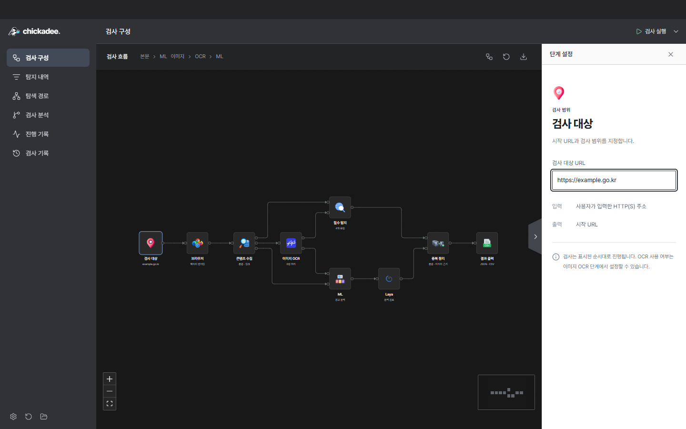
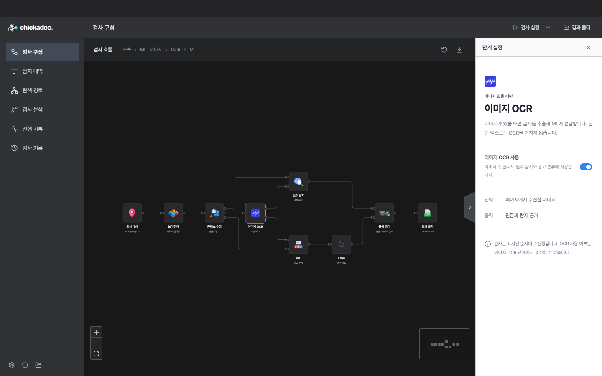
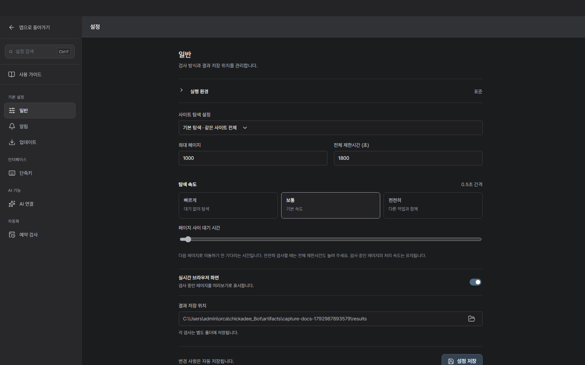
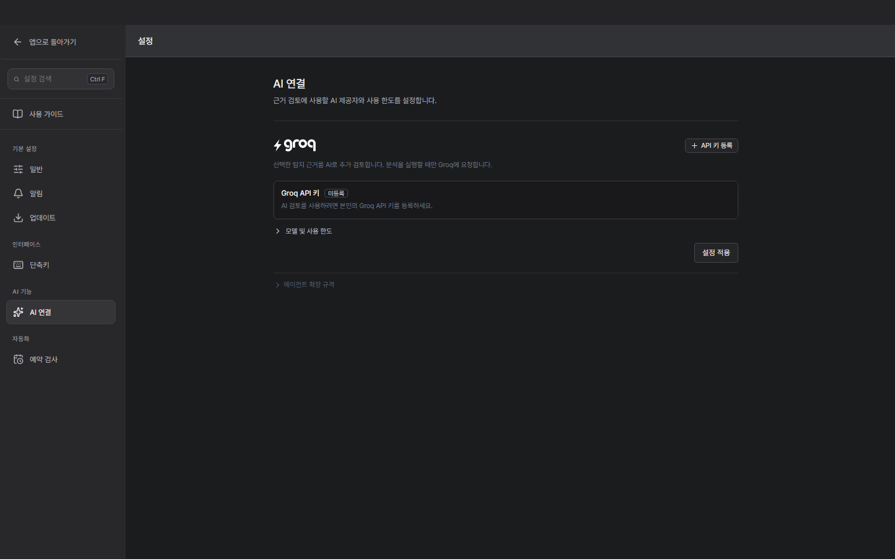
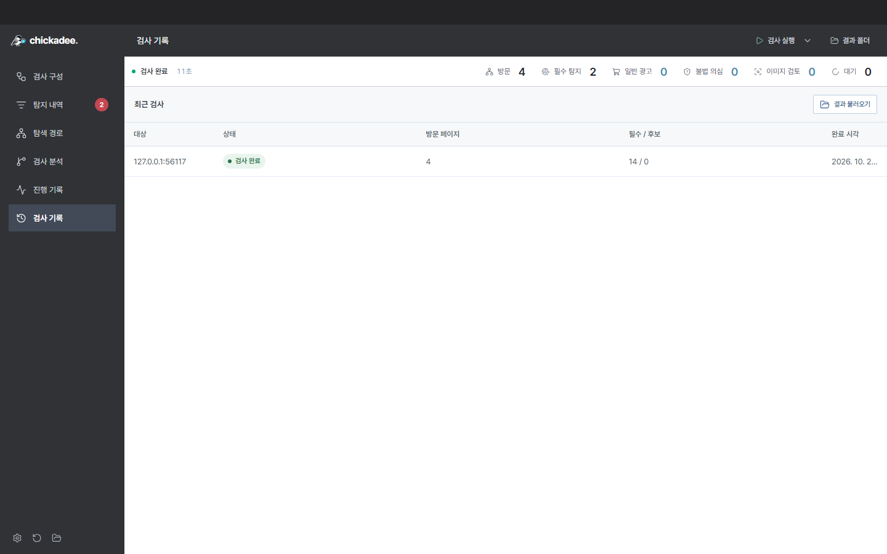
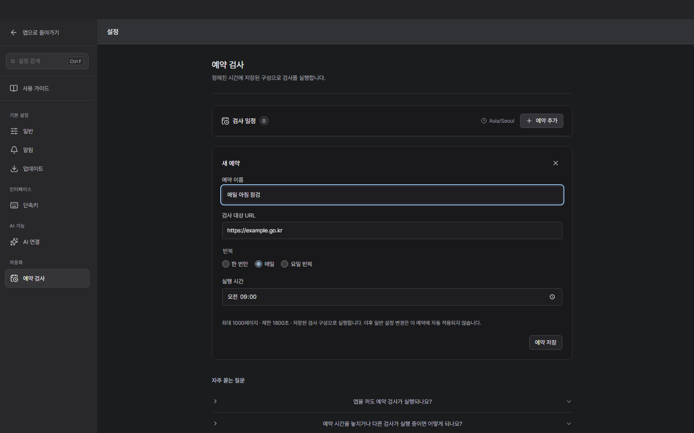
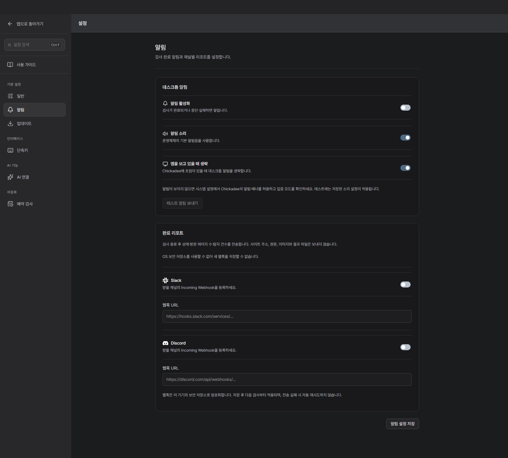

# Chickadee Studio 사용 가이드

[한국어](desktop.ko.md) | [English](desktop.md)

현재 데스크톱 앱 기준입니다. 처음 사용한다면 검사 시작 → 구성·OCR → 탐지·검토 순서로 읽으세요. 앱 안에서는 **설정 → 사용 가이드**에서 같은 내용을 볼 수 있습니다.

## 로컬 개발

저장소의 Python 환경과 `desktop` 의존성을 준비한 뒤 실행합니다. Windows에서는 설치된 Microsoft Edge의 별도 개발 창을 사용합니다.

```powershell
cd C:\Users\castle\Desktop\project\chickadee_studio\desktop
npm run dev
```

- 실제 Python 검사 엔진 연결. 화면 소스 저장 시 재빌드와 화면 갱신.
- Python 엔진 코드를 바꾸면 개발 창을 닫고 다시 실행.
- 검사 중에는 갱신을 미루고 검사 종료 후 반영.
- 개발 설정과 결과는 `artifacts/dev-session`에 분리 저장.
- 기존 로컬 OCR·ML·Laya 준비 환경 사용. 모델이나 API 키 자동 다운로드·등록 없음.
- 파일 선택 창·OS 알림·별도 로그인 창은 Electron 앱에서 확인.
- 개발 창 닫기 또는 실행 터미널의 Ctrl+C로 종료.

이 개발 창은 브라우저 기반 미리보기입니다. Electron의 설치·서명·네이티브 기능 검증을 대신하지 않습니다. 서버는 `127.0.0.1`에만 열리며 Python 제어용 HTTP API를 공개하지 않습니다.

## 목차

1. [검사 시작](#guide-1)

2. [구성·OCR](#guide-2)

3. [속도·환경](#guide-3)

4. [진행 확인](#guide-4)

5. [탐지·검토](#guide-5)

6. [AI 검토](#guide-6)

7. [기록·내보내기](#guide-7)

8. [예약 검사](#guide-8)

9. [알림](#guide-9)

10. [앱 관리](#guide-10)

<a id="guide-1"></a>

## 1. 첫 검사는 주소 입력부터 시작합니다

검사 구성은 실행할 작업을 보여주고, 검사 분석은 실행하면서 수집한 근거를 보여줍니다.



### 대상 입력

왼쪽 검사 구성에서 검사 대상 노드를 누릅니다. 오른쪽 검사 대상 URL에 http:// 또는 https://로 시작하는 주소를 입력하세요.

### 범위 확인

왼쪽 아래 톱니바퀴 → 설정 → 일반에서 최대 페이지, 전체 제한시간, 사이트 탐색 설정을 확인합니다. 설정 화면의 앱으로 돌아가기를 누르면 이전 화면으로 돌아옵니다.

### 검사 실행

상단 검사 실행을 누릅니다. 실행 옆 펼침 메뉴의 이 페이지만 검사로 시작하면 입력한 페이지로 범위를 좁힐 수 있습니다.

### 처음이라면

가이드 마지막의 데모로 연습하기 또는 검사 실행 옆 메뉴의 데모 검사를 사용하세요. 내장 예제로 탐지와 검토 흐름을 확인할 수 있습니다.

주소 예시: `https://example.go.kr`

검사가 시작되지 않으면 URL 형식과 엔진 준비 상태를 확인하세요. 검사 중에는 일부 설정을 변경할 수 없습니다.

<a id="guide-2"></a>

## 2. 고정된 검사 흐름과 이미지 OCR

8개 노드는 정해진 파이프라인입니다. 연결선을 직접 잇거나 삭제할 필요가 없습니다.



### 전체 흐름

검사 대상 → 브라우저 → 콘텐츠 수집 후 필수 탐지와 광고 분류를 수행합니다. 이미지 OCR은 이미지의 글자를 읽어 두 분석에 전달하고, 중복 정리 후 결과를 출력합니다.

### OCR 켜기

이미지 OCR 노드를 누르고 이미지 OCR 사용을 켭니다. PaddleOCR가 지원되는 이미지·배경 이미지의 한국어 글자를 로컬 CPU에서 읽습니다. 직접 학습하거나 API 키를 넣을 필요는 없습니다.

### 절약 모드 확인

설정 → 일반 → 실행 환경이 절약이면 노드에서 OCR을 켜도 이미지 OCR을 생략합니다. OCR이 필요하면 표준을 선택하고 OCR 기능 확인으로 모델 구동을 점검하세요. 자동 모드는 기기 자원에 따라 선택됩니다.

### 처리 결과 읽기

OCR 실패·판독 불가·생략은 탐지 없음과 다릅니다. 결과의 OCR 안내와 이미지 근거를 확인하세요. 같은 페이지·유형·문구의 본문/OCR 결과는 합치되 각각의 근거는 보존합니다.

노드 위치는 옮길 수 있지만 분석 경로는 고정입니다. 모델 누락이나 처리 한도 때문에 일부 이미지를 읽지 못할 수 있습니다.

<a id="guide-3"></a>

## 3. 다른 작업과 함께 검사하도록 조절합니다

설정 → 일반에서 탐색 범위, 페이지 간격, 실행 환경, 저장 위치를 관리합니다.



### 페이지와 시간

최대 페이지는 방문할 페이지 수의 상한입니다. 설정의 제한시간은 웹 수집에 적용합니다. 수집한 본문과 OCR 문구의 로컬 분석은 별도의 최대 30분 안에서 이어집니다. 분석 중에도 검사 중단을 사용할 수 있습니다. 수집 한도에 도달하면 사이트 전체를 확인한 것으로 해석하지 마세요.

### 천천히 탐색

빠르게는 0초, 보통은 0.5초, 천천히는 5초 간격입니다. 슬라이더로 0~30초를 지정할 수도 있습니다. 다음 페이지로 이동하기 전의 대기 시간이며 현재 페이지의 처리 속도를 낮추는 기능은 아닙니다.

### 실행 환경

자동은 기기 자원에 맞춰 모드를 정합니다. 표준은 사용 가능한 OCR과 로컬 AI를 사용하고, 절약은 이미지 OCR을 생략합니다. 필수 탐지는 유지됩니다. 기능 상태와 OCR 기능 확인 결과를 함께 보세요.

### 저장과 미리보기

결과 저장 위치의 폴더 아이콘으로 저장할 곳을 선택합니다. 각 검사는 별도 폴더에 저장됩니다. 실시간 브라우저 화면을 끄면 미리보기 화면을 표시하지 않습니다.

천천히 검사할 때는 전체 제한시간도 늘려 주세요. 설정 검색에 속도, OCR, 저장 등을 입력하면 관련 메뉴를 찾을 수 있습니다.

<a id="guide-4"></a>

## 4. 현재 작업과 실제 방문 경로를 구분해서 봅니다

검사 구성, 탐색 경로, 진행 기록, 검사 분석은 각각 다른 정보를 보여줍니다.


### 구성과 경로

검사 구성의 노드는 처리 단계입니다. 탐색 경로에서는 방문한 주소와 대기 주소를 확인합니다. 검사 분석 → 탐색 그래프는 START부터 수집된 페이지·상태·영역의 관계를 보여줍니다.

### 근거 선택

탐색 그래프에서 관측 노드를 누르면 해당 문구와 로컬 AI 결과, 확보된 이미지·스크린샷 근거를 볼 수 있습니다. START와 END는 흐름의 시작과 끝을 표시합니다.

### 미리보기

검사 구성 오른쪽 가장자리 버튼으로 미리보기 패널을 엽니다. 표시되는 화면은 주기적으로 촬영한 이미지이며 연속 영상이 아닙니다. 스크린샷의 확대 아이콘은 중앙 모달을 엽니다.

### 일시정지와 중단

일시정지는 현재 페이지 처리를 정리한 뒤 적용되며 검사 재개로 이어갑니다. 검사 중단은 실행을 끝내고 수집된 결과를 저장합니다. 오류와 단계별 동작은 진행 기록에서 확인하세요.

그래프에 모든 관측을 표시하지 못하면 생략 건수나 수집 한도 안내가 나타납니다. 화면에 보이는 노드 수만으로 전체 검사량을 판단하지 마세요.

<a id="guide-5"></a>

## 5. 발견한 문구와 화면을 함께 확인합니다

탐지 내역에서 의심 항목을 읽고 직접 검토 상태와 메모를 남깁니다.


### 항목 찾기

전체·필수 탐지·광고 의심 탭과 문구·URL 검색을 사용합니다. 검토 필터로 미검토 항목을 모아 볼 수 있습니다. 필수 탐지는 문자 위장·자모·투명·화면 밖 은닉을, 광고 의심은 광고 문맥 후보를 보여줍니다.

### 근거 읽기

항목을 누르고 발견한 문구, 탐지 이유, 페이지·기술 정보를 확인합니다. 원본 URL은 클릭해 브라우저로 열거나 복사할 수 있습니다. 원문 접속은 실제 사이트로 이동합니다.

### 이미지 확인

스크린샷은 확대 아이콘으로 열고 Esc 또는 닫기로 닫습니다. OCR 항목은 이미지 속 글자 위치와 신뢰도도 확인하세요. 저장된 화면이 없는 항목은 원문·CSS 등 남아 있는 근거로 검토합니다.

### 상태 남기기

메모를 입력하고 검토 확인 또는 제외를 누릅니다. 항목 메뉴에서 메모만 저장하거나 미검토로 되돌릴 수 있습니다. 여러 항목을 선택하면 일괄 검토도 가능합니다.

탐지와 AI 의견은 의심 근거입니다. 검토 확인·제외는 사용자의 판단이며 원본 결과와 별도로 저장됩니다.

<a id="guide-6"></a>

## 6. 로컬 분석과 외부 AI 추가 검토를 구분합니다

검사 분석 → AI 검토에서 수집한 전체 영역을 검토하고 리포트로 저장합니다.



### 기본 분석

필수 탐지와 로컬 문자·피싱 화면 AI, 이미지 OCR에는 외부 AI API 키가 필요하지 않습니다. 사용 가능한 모델과 실행 환경에 따라 처리되며 결과는 검토를 돕는 근거입니다.

### AI 연결

외부 AI로 추가 검토하려면 설정 → AI 연결에서 Groq API 키 등록을 누르고 키를 입력한 뒤 설정 적용을 누릅니다. 현재 연결 제공자는 Groq입니다. 키는 현재 세션에서만 사용되며 앱을 종료하면 삭제됩니다.

### 전체 검토

검사가 끝난 결과나 검사 기록을 연 뒤 검사 분석 → AI 검토 → 전체 검토 시작을 누릅니다. 탐지 목록의 필터와 관계없이 전체 수집 영역을 대상으로 합니다. 키 등록만으로 검토가 자동 실행되지는 않습니다.

### 한도와 저장

모델 및 사용 한도에서 누적 호출·토큰 한도를 조절합니다. 검토 안내 및 사용량에서 현재 검사 기준 사용량을 확인하세요. 중단하거나 한도에 도달하면 완료된 부분만 남으며, 결과가 있으면 리포트 저장으로 Markdown을 내려받습니다.

키 등록 표시는 연결 성공을 뜻하지 않습니다. 실제 요청 시 연결을 확인합니다. 외부 AI 검토를 실행하면 선택된 근거 문맥이 해당 제공자에게 전송됩니다.

<a id="guide-7"></a>

## 7. 검사별 결과 폴더를 함께 보관하세요

검사 결과는 자동 저장되며, 이전 기록을 열어 탐지·근거·검토 상태를 다시 확인할 수 있습니다.



### 기록 열기

왼쪽 검사 기록에서 원하는 실행을 선택합니다. 완료, 일부 결과, 중단, 실패 상태를 먼저 확인하세요. 일부 결과는 제한이나 오류로 확인하지 못한 범위가 있다는 뜻입니다.

### 다른 결과 불러오기

왼쪽 아래 결과 불러오기 아이콘으로 result.json을 선택합니다. scan-report.json, review.json, 근거 이미지 등은 같은 결과 폴더에 함께 보관해야 상세 정보를 복원할 수 있습니다.

### 엑셀 내보내기

탐지 내역의 엑셀 저장에서 Excel 또는 CSV 선택. 항목을 선택하면 선택 항목만 저장. 선택 항목이 없으면 전체 저장. Excel에는 원문과 주소 및 OCR 추출문과 검토 상태 포함. CSV는 기존 고정 열 형식 유지. [열 구성과 사용법](excel-export.ko.md) 참고.

### 공유할 때

result.json은 필수 탐지, scan-report.json은 광고 후보·오류·OCR 등 상세 결과를 담습니다. 이미지 근거까지 전달하려면 파일 하나만 보내지 말고 해당 검사 폴더 전체를 보관·전달하세요.

스크린샷이 없다고 탐지가 실패한 것은 아닙니다. 촬영 실패나 이미지 파일 누락일 수 있으므로 남아 있는 근거와 진행 기록을 확인하세요.

<a id="guide-8"></a>

## 8. 매일 오전 9시 검사를 예약합니다

설정 → 예약 검사에서 실행 시간과 반복 요일을 지정합니다.



### 설정 먼저 준비

검사 대상 URL, 페이지 수, 제한시간, 속도, OCR 구성을 먼저 맞춥니다. 예약은 추가할 때의 검사 구성을 저장하므로 이후 일반 설정 변경이 기존 예약에 자동 반영되지는 않습니다.

### 예약 추가

예약 추가를 누르고 이름과 URL을 확인합니다. 매일과 09:00을 선택하거나 한 번만·요일 반복으로 날짜와 요일을 지정한 뒤 예약 저장을 누릅니다.

### 실행 조건

목록의 시간대와 다음 실행 시각, 활성화 상태를 확인하세요. 앱이 실행 중이고 컴퓨터가 깨어 있어야 합니다. 다른 검사나 AI 검토와 겹치거나 시간을 놓친 예약은 재실행 없이 건너뜁니다.

### 관리와 결과

예약의 토글로 활성화 여부를 바꾸고 연필로 수정하거나 휴지통으로 삭제합니다. 마지막 실행 안내에서 건너뛴 이유를 확인하고, 실제 실행 결과는 검사 기록에서 엽니다.

예약 검사는 운영체제의 백그라운드 작업 등록 기능이 아닙니다. 앱 종료·절전 상태에서는 실행하지 않습니다.

<a id="guide-9"></a>

## 9. 검사 종료를 알림과 채널 요약으로 받습니다

설정 → 알림에서 데스크톱 알림과 Slack·Discord 완료 리포트를 각각 설정합니다.



### 데스크톱 알림

알림 활성화, 소리, 앱을 보고 있을 때 생략을 선택하고 알림 설정을 저장합니다. 테스트 알림 보내기로 확인하세요. 배너가 없으면 시스템의 알림 허용·집중 모드를 확인합니다.

### 웹훅 등록

Slack 또는 Discord 채널에서 발급한 웹훅 주소를 해당 입력란에 넣고 전송을 켠 뒤 저장합니다. 새 웹훅 저장에는 운영체제 보안 저장소가 필요합니다.

### 보내는 내용

검사가 완료·중단·실패하면 상태, 방문 페이지 수, 탐지 건수 요약을 보냅니다. 사이트 주소, 원문, 이미지, 결과 파일은 보내지 않습니다. 전체 근거는 앱의 검사 기록에서 확인하세요.

### 예약과 함께

예약 검사의 종료에도 같은 알림 설정을 사용합니다. 알림을 받는 것과 AI 검토를 실행하는 것은 별개이며, 웹훅 등록이 AI 리포트 생성을 자동 시작하지는 않습니다.

웹훅 주소는 채널 전송 권한을 가진 값입니다. 가이드나 스크린샷에는 실제 주소를 넣지 마세요.

<a id="guide-10"></a>

## 10. 업데이트·단축키·재실행을 관리합니다

설정 검색으로 필요한 항목을 찾고, 자주 쓰는 조작을 단축키로 지정할 수 있습니다.


### 업데이트 확인

설정 → 업데이트에서 업데이트 확인을 누릅니다. 다운로드 버튼은 지원되는 새 배포 파일이 있을 때 활성화됩니다. GitHub 릴리스에서 버전별 설명과 파일도 확인할 수 있습니다.

### 새 버전 실행

업데이트 다운로드 후 파일 검증이 완료되면 파일 위치 열기를 누릅니다. 앱을 종료하고 ZIP을 새 폴더에 풀어 새 실행 파일을 여세요. 현재 배포 방식은 앱을 자동 교체하지 않습니다.

### 단축키 설정

설정 → 단축키에서 명령을 찾고 원하는 키 조합을 지정합니다. 중복되거나 사용할 수 없는 조합은 화면 안내를 확인하세요. 기본값으로 되돌릴 수도 있습니다.

### 앱 재실행

왼쪽 아래 회전 화살표는 앱 재실행입니다. 검사 중에는 사용할 수 없습니다. 재실행하면 세션에 등록한 AI API 키는 다시 입력해야 합니다.

실제 탐지·검토를 익히려면 데모로 연습해 보세요.

## 개발·상세 문서

- [Python CLI·호환판 설명서](manual.ko.md)
- [결과 파일 형식](result-format.ko.md)
- [Windows 서명 정책](windows-signing.ko.md)
- [로컬 도구·AI 확장 규격](agent-extension.ko.md)

## 접근 확인과 공유 리포트

- **설정 → 검사기 인증 → WAF 허용 규칙 안내**에서 보호된 URL과 로그인 상태 확인 문구 입력
- **접근 확인**은 인증 없는 요청과 인증 헤더를 넣은 요청을 비교
- 인증 없이도 같은 문구가 표시되면 공개 페이지로 표시. 인증 성공으로 단정하지 않음
- HTTP 429는 추가 확인 중단
- **서버 규칙 복사**는 Cloudflare용 조건식 복사. 토큰은 WAF에서 직접 입력
- 조건식은 서버 시각 기준 만료 시각 포함. WAF에 실제 등록해야 효력 발생
- 앱의 인증 해제와 서버 규칙 삭제는 별도. 운영자가 서버 규칙도 폐기
- **리포트 저장 → 원본 리포트**는 기존처럼 원문과 캡처 포함
- **리포트 저장 → 공유용 리포트**는 개인정보와 활성 키를 가린 텍스트 사본 저장
- 공유본에서 캡처 이미지 제외. 이미지 속 개인정보는 자동으로 가려졌다고 보장하지 않음
- 원본 리포트와 이미지는 결과 폴더에 보존

접근 확인은 [ZAP의 로그인 상태 확인 방식](https://www.zaproxy.org/docs/desktop/start/features/authstrategies/)을 참고했습니다. 서버 만료 조건은 [Cloudflare 요청 시각 필드](https://developers.cloudflare.com/ruleset-engine/rules-language/fields/reference/http.request.timestamp.sec/)를 사용합니다.

## 이미지 처리 상태

- 출처 제한과 이미지 접근 권한 오류 구분
- 요청 제한과 연결 시간 초과 구분
- 지원 형식과 크기 제한 구분
- OCR 모델 준비 오류와 인식 시간 초과 구분
- 문자 영역 없음과 문자 신뢰도 부족 구분
- 검사 분석의 OCR 통계에서 사유별 건수 확인

## 검사 네트워크 보호

- 웹페이지와 로그인 창은 검증한 주소로 연결하는 로컬 프록시 사용
- 이미지와 사이트 아이콘도 같은 주소 검증 적용
- 외부 도메인이 내부 IP로 해석되면 연결 차단
- DNS 검사에 통과한 숫자 주소로 직접 연결. 연결 과정에서 별도 DNS 재조회 없음
- 직접 입력한 내부 IP 또는 `localhost`는 해당 IP와 포트만 허용
- 내부 DNS 이름은 자동 허용하지 않음. 운영자가 사이트 프로필의 `private_addresses`에 정확한 내부 IP를 등록하면 해당 호스트와 포트에서만 허용
- 운영체제 보안 설정과 인증서 저장소 변경 없음

문서의 화면은 격리된 로컬 데모와 현재 렌더러로 촬영했습니다. 실제 사이트, API 키, 웹훅은 사용하지 않았습니다.

## 검사 도중 로그인이 필요한 경우

첫 이동뿐 아니라 수집 중 로그인 주소로 이동하거나 HTTP 401 응답·보이는 비밀번호 입력칸을 발견하면 검사를 기다리게 하고 **로그인 필요** 모달과 데스크톱 알림을 표시합니다. 운영체제 알림이 허용되지 않아도 앱 모달에서 조작할 수 있습니다.

1. **로그인**를 눌러 별도 창에서 직접 로그인합니다.
2. 로그인이 끝나면 Chickadee로 돌아와 **검사 재개**를 누릅니다.
3. 앱이 인증 쿠키를 검사 브라우저로 전달하고 원래 요청한 페이지를 다시 확인합니다. 여전히 로그인 화면이면 다시 안내합니다.

창만 닫으면 검사를 재개하지 않습니다. **이 페이지 건너뛰기**를 누르면 해당 페이지를 인증 필요로 미수집 처리하고 남은 페이지로 진행합니다. **검사 중단**은 수집된 결과를 저장하며 실행을 끝냅니다. 로그인 대기 시간은 페이지·전체 검사 제한시간에서 제외합니다.

비밀번호는 앱이 읽거나 저장하지 않습니다. 로그인 창은 앱 API와 분리된 임시 브라우저 세션이며, 쿠키는 이번 검사에서만 메모리로 사용합니다. 다음 검사·예약까지 로그인을 유지하지 않습니다. 현재는 쿠키 기반 로그인을 지원하며, 다른 도메인의 로그인 주소로 리다이렉션돼도 로그인 창에서 인증할 수 있습니다. 검사 사이트에 발급된 쿠키만 전달하며, 팝업 인증·localStorage 기반 인증은 지원되지 않을 수 있습니다. 로그인 주소가 일반적인 login/signin/sso/authorize 형태가 아니고 비밀번호 입력칸도 없는 경우에는 자동 감지가 되지 않을 수 있습니다. 단순히 ‘로그인’ 링크가 있는 것만으로는 인증 필요로 처리하지 않습니다.
