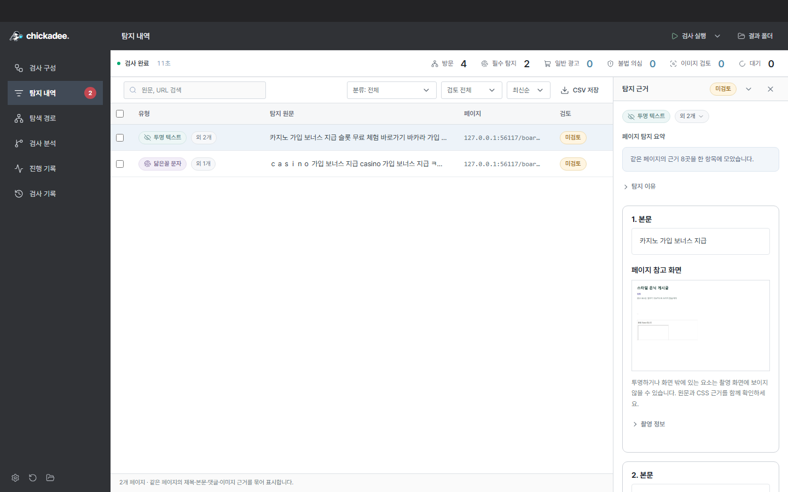

# Exploration graph and AI evidence review

[한국어](inspection-agent.ko.md) | [English](inspection-agent.md)

Inspect observed navigation and collected evidence, then optionally use the selected AI provider to review advertising context.

## Interface

Open **검사 분석** (Inspection analysis) for the exploration graph and AI review. Processing counts and score distributions are shown for ML, Laya and OCR; unused models do not get invented scores.

The exploration graph shows discovered pages, DOM collection states, scrolling, states after read controls and iframe collection through observed edges. Select a node for evidence. This differs from the workflow-stage graph and updates live while open.

For AI review, configure key/model/limits and select **전체 검토 시작**. Suspected-ad evidence is prioritized; stopping or reaching limits preserves unreviewed counts. Save HTML with screenshots or Markdown. HTML can be printed to PDF. There are no automatic calls. Keys remain in session memory, not history/settings/repository files; limits can be lowered without re-entering an existing session key.

## Collection and character analysis

Evidence packets include regions not classified as ads. Region boundaries use existing `content_scope` post/comment markup and direct-text elements. Missing semantic scope is recorded as `scope_quality=element`. Parent regions overlapping multiple posts/comments are marked `overlapping` and AI opinions are withheld.

Packets retain original text (up to 4,000 characters), URL, selector, frame path, observation time, snapshot ID, original-text SHA-256, observed computed styles, hiding evidence and link strings. Uncollected styles are null. Frame hiding flags are separate. Evidence is reused across states while preserving final observation order, including values that change and revert.

Limits per run: 1,000 regions, about 6 MB of packet text, 3,000 DOM states and 1,000 displayed graph nodes. Excess is marked `truncated`; existing text/scroll/page limits also apply.

The app pins Unicode confusables **18.0.0 with 1,351 restricted mappings** locally, mapping non-ASCII single characters to ASCII while retaining Korean/Jamo handling. It avoids broad ASCII-to-ASCII substitutions, preserves source positions, context requirements and benign exceptions. Invisible format-character insertion and mixed scripts are supporting patterns; format characters alone do not create HOMOGLYPH findings. This is not a complete UTS #39 implementation or universal language coverage.

Version, source SHA-256 and filtering are in `chickadee/data/confusables-ascii.json`; the license is `chickadee/data/LICENSE-UNICODE.txt`. No Unicode server is contacted at runtime.

## AI execution and costs

Choose **Groq, OpenAI (GPT), or Anthropic (Claude)** under Settings → AI connection and enter that provider’s API key. Switching provider requires a new key; model/limit changes for the same provider can reuse the current session key. Keys are not saved to disk and are forgotten on exit. ChatGPT/Claude subscriptions do not include API billing.

| Provider | Default model | Endpoint |
| --- | --- | --- |
| Groq | `openai/gpt-oss-20b` | `https://api.groq.com/openai/v1/chat/completions` |
| OpenAI | `gpt-4.1-mini` | `https://api.openai.com/v1/chat/completions` |
| Anthropic | `claude-haiku-4-5-20251001` | `https://api.anthropic.com/v1/messages` |

Model IDs are editable. Requests go only to the selected provider’s fixed official endpoint; built-in search and code execution are not used.

1. The model selects reads from `evidence_read`, `style_read`, `text_analyze` and `local_ai_read`.
2. The app validates evidence IDs/arguments and reads collected evidence only. Arbitrary URLs, files, commands, other-run evidence and changes to findings/human review are disallowed.
3. A separate request returns a JSON opinion, checked against JSON Schema and evidence actually read. Short/truncated text or opinions without a body read are deferred.

Since 0.8.0, insufficient evidence, deferral or requests for more evidence can trigger bounded same-site exploration. The model selects at most two allowed link IDs from original-region links, the pending queue, observed pages or revisiting the source page. Scheme, host and port must match. Common login/delete/download paths and action/token queries are excluded. Arbitrary URLs, model JS/shell/form input and recursive discovery are not executed. GET requests can still have site-specific side effects.

Exploration uses a separate temporary Chromium context with basic scrolling and DOM/CSS collection. It does not inherit extra resource origins or profile click actions. The model receives at most two regions per page, 600 characters each, plus collection status; screenshots are not sent. Original and additional IDs are validated to avoid mixing another post's ad into the original evidence. Same origin does not guarantee the same post; human review remains necessary.

| Limit | Value |
| --- | --- |
| Basic review | 2 model requests; at most 4 evidence reads |
| With exploration | Up to 4 requests including planning and reassessment |
| Output per request | 1,024 tokens |
| Total review time | 30 seconds |
| Single HTTP wait | 10 seconds |
| Additional page | Up to 20 seconds including OCR startup, within remaining time; reserve 3 seconds for reassessment |
| Additional visits | 2 per analysis, 6 cumulatively per scan |
| Default cumulative budget | 6 calls and 24,000 tokens per scan |

Cancellation is checked before/after requests; already-sent costs cannot be undone. Failures, 429s and invalid formats do not cause automatic retries/provider switching. Incomplete exploration preserves insufficient-evidence state and history.

Before each request, the app conservatively reserves tokens from UTF-8 size and saves usage/limits to `agent.json`. Successful provider usage settles the reservation; failures or missing usage retain it. Fewer than two remaining calls prevents starting another review. Reopening a run continues its budget; stored limits can be lowered, not raised. New scans have independent budgets. These are app call/token limits, not account-wide dollar limits; use [Groq account limits](https://console.groq.com/settings/limits) for broader controls.

Only selected excerpts and requested tool results are sent. Body reads are capped at 1,600 characters. URLs, emails, phone numbers and key-like strings are masked. Cookies, authentication headers, raw HTML and full screenshots are not sent. Free-form personal information may remain. Page instructions are treated as data and tool authority is separately bounded. See [Groq data policy](https://console.groq.com/docs/your-data).

## Storage and local API

`result.json` and the 17-column CSV retain their formats. HTML/Markdown reports store scan summaries, statistics, evidence IDs/locations, opinions and usage, including completed opinions and unreviewed counts after interruption. `scan-report.json` includes `exploration`, `evidence_packets` and `screenshots`. `agent.json` holds opinions, usage, recent actions and `explorations` (pages, context, captures and blocked requests). Additional exploration does not overwrite the scan report. Sidecars bind to original-result SHA-256. Corrupt usage records lock paid requests for that run instead of resetting costs. Human `review.json` is not overwritten.

### Evidence screenshots

Viewport evidence captures share one JPEG per DOM state, with limits of 64 images, 200 KB each and 8 MB total. Hidden styles are not forced visible. Review transparent/offscreen text alongside original text and CSS. DOM capture and screenshot happen sequentially, so dynamic pages can change between them. Timestamps, state IDs, URLs and integrity hashes are recorded. For newer element captures and historical-reference labeling, see [Direct analysis and shared processing](content-analysis.md#shared-processing-with-website-scans).

Open/enlarge screenshots in the evidence panel or after reopening history. Originals are in `evidence/<SHA-256>.jpg`; additional exploration uses `agent-<SHA-256>.jpg`. Older records, capture failures or storage limits fall back to text/CSS. Images remain local. Capture uses the [Playwright screenshot API](https://playwright.dev/python/docs/screenshots).



The existing stdio bridge adds these commands without an HTTP port:

| Command | Arguments | Result/effect |
| --- | --- | --- |
| `inspection` | `run_id` | Graph, regions and agent state |
| `agent-configure` | Initial `api_key`, `model`, `token_limit`, `call_limit` | Session key; retained for later limit changes, removed on exit |
| `agent-run` | `run_id`, `evidence_id` | Background evidence review |
| `agent-status` | None | Configuration, run status, usage and opinions |
| `agent-stop` | None | Cancellation request |

Windows supports `Chickadee.exe --groq-env-file 'C:\Chickadee\.env'`, reading only `GROQ_API_KEY` from that explicitly selected file without executing it or expanding other variables. Loading a key makes no request and retains limits. See [Quick start](quickstart-windows.md).

`inspection.read` and `agent.status` are also local tools. Paid commands and authentication configuration are not exposed to the review model. `agent_connected` indicates session configuration; `agent_available=true` and `providers=["groq", "openai", "anthropic"]` indicate implementation availability.

## Validation and reruns

Local fixtures exercise real Chromium scans, changed links/text/opacity, history reload and unchanged original results. Deterministic agent responses test invalid tools, wrong/invented IDs, budgets and cancellation. Renderer tests connect to the real Python bridge and are separate from native package checks.

```powershell
.\.venv\Scripts\python.exe -m unittest discover -s tests -v
cd desktop
npm run build
npm test
$env:PLAYWRIGHT_BROWSERS_PATH = '..\.venv\Lib\site-packages\playwright\driver\package\.local-browsers'
node tests/inspection-smoke.cjs
```

Paid live checks are excluded from automatic tests. Run explicitly when needed; synthetic text and persisted usage keep reruns within the existing budget:

```powershell
.\.venv\Scripts\python.exe scripts/verify_groq_agent.py --output artifacts/groq-live-check.json
# Alternatively: --env-file <explicit dotenv path>; reads only GROQ_API_KEY.
```

The 0.7.0/0.8.0 live checks were historical Groq runs. Preserve `examples/groq-agent-smoke-2026-10-21.json` and `examples/groq-exploration-smoke-2026-10-21.json`. In 0.10.1, the live model list and default-model evidence/JSON flow were checked again.
